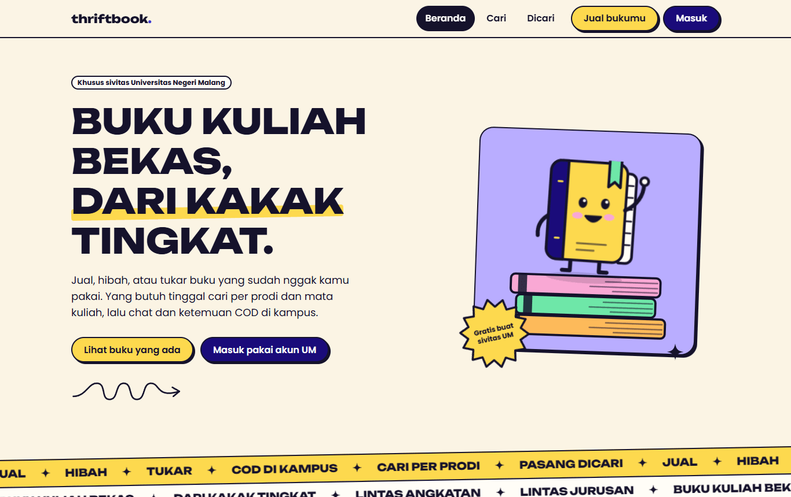
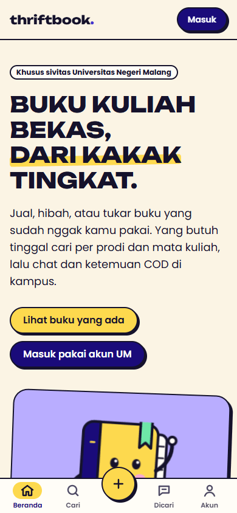
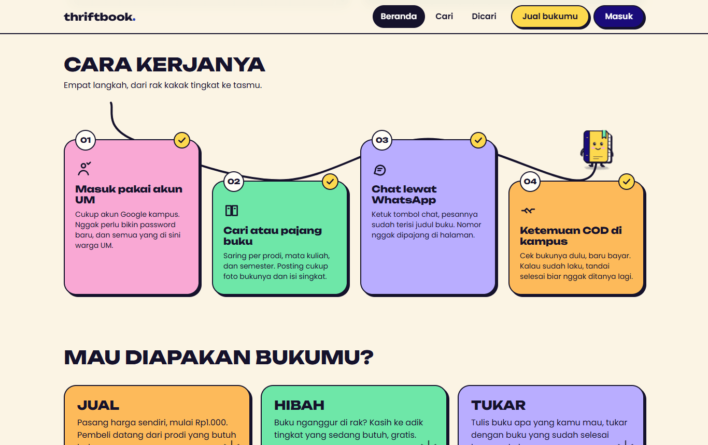
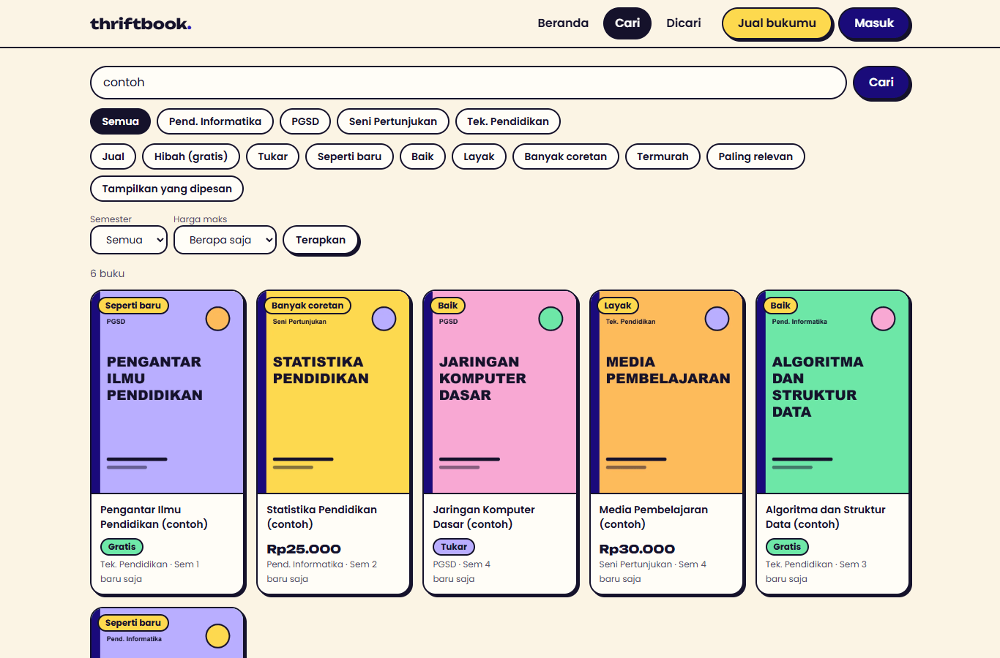
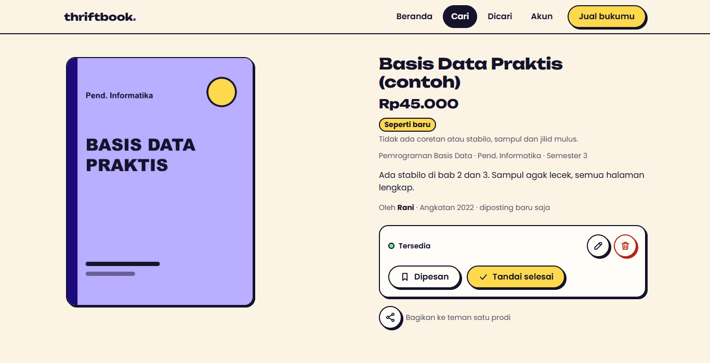
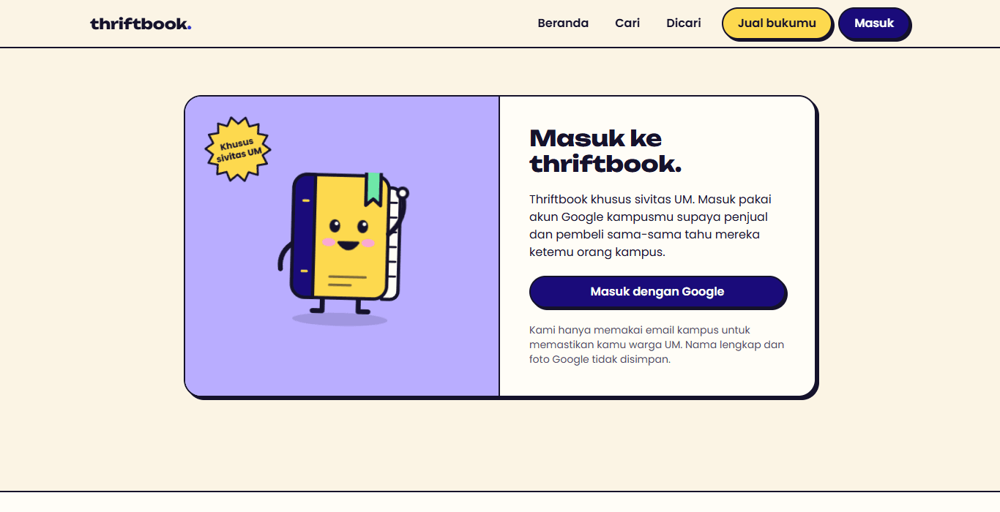

<div align="center">

# thriftbook.

**Papan buku kuliah bekas untuk mahasiswa Universitas Negeri Malang.**
Jual, hibah, atau tukar buku yang sudah tidak terpakai. Cari per prodi dan mata kuliah, lalu
chat lewat WhatsApp dan ketemuan COD di kampus.




</div>

---

## Daftar isi

- [Masalah yang ingin diselesaikan](#masalah-yang-ingin-diselesaikan)
- [Cara kerja untuk pengguna](#cara-kerja-untuk-pengguna)
- [Fitur](#fitur)
- [Tampilan](#tampilan)
- [Keamanan dan privasi](#keamanan-dan-privasi)
- [Tech stack](#tech-stack)
- [Menjalankan secara lokal](#menjalankan-secara-lokal)
- [Struktur proyek](#struktur-proyek)
- [Pengujian](#pengujian)
- [Deploy](#deploy)
- [Dokumentasi lain](#dokumentasi-lain)
- [Batasan yang diketahui](#batasan-yang-diketahui)
- [Tentang proyek](#tentang-proyek)

## Masalah yang ingin diselesaikan

Mahasiswa baru sering kesulitan menemukan buku kuliah dengan harga terjangkau, sementara kakak
tingkat punya buku bekas yang menganggur tetapi tidak punya wadah khusus untuk menyalurkannya.
Saat ini keduanya bertemu lewat menfess di X, yang unggahannya cepat tenggelam, sulit dicari
per mata kuliah, dan tidak terstruktur.

> Pertanyaan yang dijawab proyek ini: *bagaimana mempertemukan pemilik dan pencari buku kuliah
> bekas di satu kampus secara cepat, murah, dan terstruktur?*

Thriftbook sengaja **tidak** menjadi marketplace penuh: tidak ada pembayaran di aplikasi, chat
sendiri, atau ongkir. Transaksi tetap terjadi lewat WhatsApp dan COD di kampus, sehingga yang
dibangun hanyalah bagian yang benar-benar hilang, yaitu katalog yang rapi dan bisa dicari.

## Cara kerja untuk pengguna

```
Masuk dengan akun Google UM  →  Cari buku / pajang bukumu  →  Chat lewat WhatsApp  →  COD di kampus
                                          │                                              │
                              Belum ada? Pasang "Dicari"                       Tandai "Selesai"
```

1. **Masuk** dengan akun Google kampus (`@students.um.ac.id` atau `@um.ac.id`). Tidak ada
   password baru, dan semua pengguna terverifikasi warga UM.
2. **Cari** buku berdasarkan judul, mata kuliah, prodi, semester, kondisi, atau harga. Atau
   **pajang** bukumu: cukup foto, judul, kondisi, dan pilih jual, hibah, atau tukar.
3. **Chat** penjual lewat tombol WhatsApp. Pesannya sudah terisi judul buku.
4. **Ketemuan** di kampus, cek bukunya, baru bayar. Tandai buku **Selesai** supaya tidak
   ditanyai lagi.
5. Belum ada bukunya? Pasang **Dicari** selama 30 hari. Pemilik buku yang menemukannya bisa
   langsung menghubungimu.

## Fitur

**Untuk pencari dan pemilik buku**

| Fitur | Keterangan |
|---|---|
| Landing page | Tamu melihat penjelasan produk dengan motion yang mengikuti scroll; yang sudah masuk langsung ke katalog |
| Jual, hibah, tukar | Harga hanya diminta untuk jual. Tukar mencatat buku apa yang diinginkan |
| Cari dan filter | Judul, mata kuliah, prodi, semester, kondisi, tipe, harga maksimal, termurah, paling relevan |
| Toleran salah ketik | "basisdata" atau "bsis data" tetap menemukan "Basis Data" |
| Kondisi 4 tingkat | Seperti baru, Baik, Layak, Banyak coretan, masing-masing dengan definisi yang jelas |
| Foto otomatis dioptimasi | Dikompres di perangkat, lalu dire-encode di server ke WebP, dengan metadata EXIF/GPS dibuang |
| Dicari | Permintaan buku 30 hari, dicocokkan dengan listing yang ada |
| Status buku | Tersedia, Dipesan, Selesai, dan otomatis Kedaluwarsa setelah 60 hari |
| Draf form | Isian posting tersimpan bila halaman tertutup atau koneksi putus |
| Bagikan | Web Share API, dengan cadangan salin tautan |
| Unduh data dan hapus akun | Hak pengguna atas datanya, termasuk penghapusan foto |
| PWA | Bisa dipasang ke layar utama, dengan halaman offline |

**Untuk moderator**

| Fitur | Keterangan |
|---|---|
| Laporan | Tujuh alasan, satu laporan per pengguna per target, batas 10 per hari |
| Auto-hide | Listing disembunyikan otomatis setelah 3 pelapor berbeda sampai ditinjau |
| Panel moderasi | Antrean laporan, sembunyikan atau tampilkan, blokir atau buka blokir, wajib menulis alasan |
| Riwayat tindakan | Append-only: tidak bisa diubah atau dihapus |
| Metrik | Listing dihubungi, tersalurkan lewat thriftbook, Dicari terpenuhi, pencarian tanpa hasil |
| Deteksi kontak mencurigakan | Akun yang membuka terlalu banyak kontak ditandai |

## Tampilan

Gaya visual neo-brutalist yang ceria: kertas krem, garis tinta tebal, bayangan keras, dan aksen
pastel di atas identitas biru tua dan kuning. Di desktop navigasi ada di atas; di layar kecil
berpindah ke bilah bawah. Maskot **Tibo** (buku kecil berwajah) menemani halaman kosong, error, dan
landing.

| Landing (desktop) | Landing (mobile) |
|---|---|
|  |  |

| Cara kerja, dengan maskot yang berjalan mengikuti scroll | Katalog dan filter |
|---|---|
|  |  |

| Halaman buku (tampilan pemilik) | Masuk |
|---|---|
|  |  |

> Tangkapan layar memakai data contoh fiktif.

## Keamanan dan privasi

Aplikasi ini memegang nomor WhatsApp mahasiswa, jadi keamanan menjadi bagian inti desain, bukan
tambahan. Ringkasannya:

- **Nomor WhatsApp tidak pernah dirender di halaman.** Nomor hanya dikirim sebagai tautan `wa.me`
  yang dibentuk server, untuk pengguna yang login dan mengetuk tombol chat, dibatasi 30 pembukaan
  per akun per hari dan 5 per menit, dan setiap pembukaan dicatat.
- **Login dibatasi akun kampus.** Pencocokan domain email dilakukan persis (bukan `endsWith`),
  berlapis di aplikasi dan di trigger database, sehingga tidak bisa dilewati dengan memanggil API
  langsung.
- **Otorisasi di database (Row Level Security).** Pengguna hanya bisa mengubah atau menghapus
  miliknya; kolom moderasi, peran, dan status blokir dilindungi trigger.
- **Unggahan foto divalidasi dari isi file**, bukan ekstensi, lalu dire-encode sehingga metadata
  (termasuk lokasi GPS) hilang. Nama file acak.
- **CSP bernonce** dan header keamanan lain, validasi input di server dengan zod, proteksi CSRF
  pada route yang mengubah data, dan tidak ada kunci rahasia di kode klien.
- **Akun diblokir** dicabut sesinya di level Auth dan hash email-nya disimpan (HMAC), sehingga
  tidak bisa mendaftar ulang lewat hapus akun.
- **Minimisasi data.** Tidak menyimpan NIM, foto profil Google, atau lokasi. Retensi dijalankan
  otomatis oleh cron harian.

Model ancaman dan pemetaan ke OWASP Top 10 serta ASVS Level 1 ada di
[PRD §7](docs/PRD-thriftbook.md).

## Tech stack

| Lapisan | Pilihan | Alasan singkat |
|---|---|---|
| Framework | Next.js 16 (App Router), React 19, TypeScript | Satu bahasa untuk UI dan server; mudah diwariskan |
| UI | Tailwind CSS 4, Poppins + Unbounded | Sistem desain kecil di `globals.css` |
| Database dan Auth | Supabase (Postgres, Google OAuth, Storage) | RLS bisa diuji; gratis tanpa kartu kredit |
| Pencarian | `ILIKE` berindeks trigram + fuzzy di server | Cukup untuk skala satu kampus |
| Gambar | `sharp` di server, `browser-image-compression` di klien | Foto adalah beban storage terbesar |
| Validasi | zod | Skema yang sama untuk form dan server |
| Hosting | Vercel Hobby (rencana) | Gratis; cron harian bawaan |
| Pengujian | `node:test`, test RLS ke database nyata | Tanpa dependensi tambahan |

Perbandingan opsi stack dan angka batas free tier ada di [PRD §8](docs/PRD-thriftbook.md).

## Menjalankan secara lokal

**Prasyarat:** Node.js 22.18 atau lebih baru (unit test memakai type-stripping bawaan Node), akun [Supabase](https://supabase.com) (gratis), dan
OAuth client Google Cloud.

```bash
git clone https://github.com/Fiz5892/thriftbook.git
cd thriftbook
npm install
cp .env.example .env     # lalu isi nilainya, lihat tabel di bawah
npm run dev              # http://localhost:3000
```

### Variabel lingkungan

| Variabel | Keterangan |
|---|---|
| `NEXT_PUBLIC_SUPABASE_URL` | `https://<project-ref>.supabase.co`, **tanpa** `/rest/v1` |
| `NEXT_PUBLIC_SUPABASE_ANON_KEY` | Kunci publik Supabase |
| `SUPABASE_SERVICE_ROLE_KEY` | **Rahasia.** Hanya di server |
| `NEXT_PUBLIC_SITE_URL` | URL situs, dipakai untuk tautan dan sitemap |
| `NEXT_PUBLIC_CONTACT_EMAIL` | Alamat kontak yang tampil di halaman Tentang |
| `CRON_SECRET` | String acak panjang untuk melindungi endpoint cron |
| `EMAIL_HASH_PEPPER` | String acak panjang untuk hash daftar blokir. Jangan diganti setelah ada akun diblokir |
| `ALLOWED_EMAIL_DOMAINS` | Domain email yang boleh masuk, dipisah koma |

### Menyiapkan Supabase

1. Buat proyek baru (pilih region terdekat dengan hosting).
2. Jalankan berurutan isi folder [`supabase/migrations`](supabase/migrations) di SQL Editor:
   `0001_init.sql`, `0002_log_event.sql`, `0003_fix_autohide.sql`.
3. Buat bucket Storage bernama `listing-photos`: publik, batas ukuran 1 MB, hanya `image/webp`.
4. Di Authentication, aktifkan provider **Google** dan **matikan** provider lain (email/password,
   magic link, anonymous). Tambahkan `http://localhost:3000/auth/callback` ke Redirect URLs.
5. Jadikan akunmu admin (sengaja tidak ada UI untuk ini):
   ```sql
   update public.profiles set role = 'admin'
   where id = (select id from auth.users where email = 'EMAIL_KAMU');
   ```

## Struktur proyek

```
src/
  app/                  Rute (App Router): halaman, server actions, route handler
    page.tsx            Landing (tamu) atau beranda (sudah masuk)
    cari/  dicari/  buku/[id]/  jual/  akun/  admin/  masuk/  onboarding/
    api/                photos, kontak WhatsApp, ekspor data, cron
    auth/callback/      Penukaran kode OAuth + pemeriksaan domain
  components/           Kartu buku, navigasi, maskot, ikon, motion scroll
  lib/                  Skema zod, klien Supabase, fuzzy search, helper WhatsApp
  proxy.ts              Refresh sesi + CSP bernonce + header keamanan
supabase/migrations/    Skema, RLS, trigger, fungsi SQL
tests/                  Unit test dan test RLS
docs/                   PRD, status implementasi, tangkapan layar
```

## Pengujian

```bash
npm test             # unit test: domain email, normalisasi WA, skema, fuzzy, deteksi bajakan
npm run test:rls     # 24 test Row Level Security ke database nyata (butuh .env)
npm run typecheck
npm run lint
```

`test:rls` membuat beberapa pengguna uji, mengujinya sebagai klien biasa terhadap aturan akses,
lalu menghapusnya. Jalankan hanya terhadap proyek Supabase milikmu sendiri.

## Deploy

1. Impor repo ke Vercel dan isi semua variabel di atas.
2. Pastikan `CRON_SECRET` terisi. [`vercel.json`](vercel.json) menjadwalkan
   `/api/cron/maintenance` setiap hari (kedaluwarsa listing, retensi data, pembersihan foto yatim).
3. Tambahkan URL produksi ke Redirect URLs Supabase dan OAuth client Google.
4. Cadangan database mingguan terenkripsi tersedia lewat
   [`.github/workflows/backup.yml`](.github/workflows/backup.yml); petunjuk secret ada di
   berkasnya.

## Dokumentasi lain

| Dokumen | Isi |
|---|---|
| [PRD](docs/PRD-thriftbook.md) | Kebutuhan fungsional, model data, threat model, rencana rilis, metrik |
| [Status implementasi](docs/STATUS.md) | Fitur yang sudah diuji, hasil Lighthouse dan axe, daftar tindakan manual |

## Batasan yang diketahui

Daftar lengkap dan jujur ada di [docs/STATUS.md](docs/STATUS.md). Yang paling relevan bagi
pembaca baru:

- **Belum diuji dengan login Google UM sungguhan.** Jalur sesudah login diuji otomatis; layar
  OAuth Google dan kebijakan Workspace UM belum.
- **LCP di halaman berfoto sekitar 3 detik** pada simulasi Slow 4G (target 2,5 detik), sebagian
  karena pengukuran dari `localhost` ke database. Perlu diukur ulang setelah deploy.
- **Daftar prodi baru berisi 4 contoh** dari mockup; daftar resmi UM belum dimasukkan.
- **Syarat Penggunaan dan Kebijakan Privasi masih draf** dan belum ditinjau pihak hukum.
- **Foto tidak bisa diganti di halaman edit** (hapus lalu posting ulang).
- **Pencarian fuzzy berjalan di server** atas maksimal 1000 listing aktif; jika katalog jauh
  lebih besar, pindahkan ke `pg_trgm` di database.

## Tentang proyek

Dikerjakan oleh Kelompok 10 untuk mata kuliah **Manajemen Inovasi**, Universitas Negeri Malang,
dengan pendekatan design thinking: *Empathize* dari unggahan menfess UM, *Define* masalah
pencari dan pemilik buku, *Ideate* dan *Prototype* fitur inti, lalu *Test* bersama mahasiswa.

Tambahkan nama anggota, lisensi, dan tautan demo di bagian ini bila sudah ditentukan.
